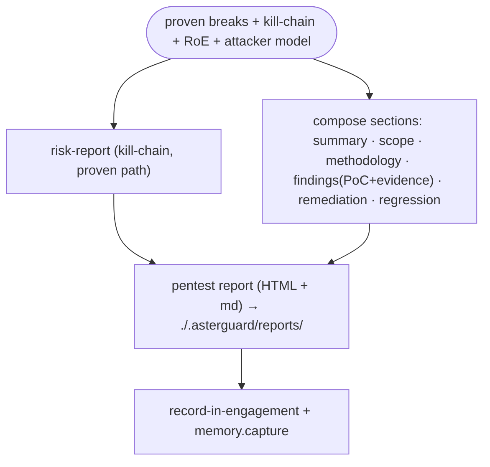

# Pentest Report (the engagement deliverable)

The offensive deliverable: not "here are some risks" but **"here is what we proved, how, and how to
break it."** Every finding carries a proof-of-concept and out-of-band evidence; the headline is the
demonstrated kill-chain. Reuses `risk-report`'s rendering and `generate-report-file`'s discipline, and
names the runbook used at the top per the reporting standard.

## When to Activate

- The reporting step of the `offensive-engineer` / `pentest` pipeline.
- Any time an authorized engagement's proven breaks need a shareable, audit-backed report.

## Objective

Turn the engagement's proven breaks + kill-chain + metrics into a report a security lead, an auditor, or
the blue team can act on — reproducible and attributable.

## Inputs

- `${PROVEN_BREAKS}`: findings from `behavioral-redteam` / `exploit-chain` (weakness, evidence, ASR).
- `${KILL_CHAIN}` + `${IMPACT}`: from `exploit-chain`.
- `${ROE}` + `${ATTACKER_MODEL}` + `${ATTACK_PLAN}`: scope/authorization, the model, the plan.

## Sections (the template)

1. **Executive summary** — the demonstrated impact in a sentence; the one path that matters.
2. **Scope & authorization** — the recorded RoE: target, in/out of bounds, who authorized, limits.
3. **Methodology** — the `attack-plan` (test kinds + techniques), the **attacker model** (named),
   strategies, canary types planted, and the **budget** (ASR@N). Reproducibility by construction.
4. **Findings** — one per proven break: weakness_id + severity, the **PoC** (the exact turns / payload /
   steps), the **evidence** (canary egress, state diff, `audit_id`), and ASR@budget. Suspected-but-
   unproven items are labeled as such, separately.
5. **Attack narrative / kill-chain** — the ordered compromise (`exploit-chain`), rendered via
   `risk-report` (the proven path in red with a `proven` badge).
6. **Remediation** — break the chain at its cheapest edge: `remediation` (policy-as-code) +
   `prompt-hardening` (instruction-layer), prioritized by impact.
7. **Regression handoff** — the broke tests become blue-team regression tests (offense feeds defense).
8. **Appendix** — the `audit_id`s for every attack action (accountability trail).

## Method

1. Gather `${PROVEN_BREAKS}`, `${KILL_CHAIN}`, `${ROE}`, `${ATTACKER_MODEL}`, `${ATTACK_PLAN}` from the
   engagement — the campaign writes one **run record** per episode (schema:
   [`behavioral-redteam/references/run-record.md`](../behavioral-redteam/references/run-record.md)) to
   `./.asterguard/runs/`, plus the roll-up `./.asterguard/engagement.json`.
2. Render the engagement via `risk-report`'s `templates/engagement-console.html` (replace its `ENGAGEMENT`
   + `RUNS` consts with those artifacts) — the console view: risk cards, kill-chain, and a transcript
   panel per run with evidence, verdict, ASR@budget and control chips. For the pure graph/attack-surface
   view use `risk-report`'s `report.html`. Compose the markdown sections above around it.
3. Cite every finding by **PoC + evidence + `audit_id`** — no evidence, no "proven".
4. Write via `generate-report-file` to `./.asterguard/reports/` (naming this runbook at the top),
   optionally the HTML Artifact; `record-in-engagement` the report + `memory.capture` the proven breaks.

## Decision Logic / Completion Criteria

- A finding is in the **Findings** section only if it has a PoC **and** out-of-band evidence; otherwise
  it goes under "suspected, unproven".
- **Done when:** every proven break has a PoC + evidence + `audit_id`, the kill-chain is rendered, the
  methodology names the attacker model + budget, and remediation + regression handoff are included.

## Integration

- **Composes:** `risk-report`, `generate-report-file`, `exploit-chain` (kill-chain), `attacker-model`
  (methodology), `remediation` + `prompt-hardening` (fixes), `engagement` + `memory-capture`.
- **Graded by:** the `evals` reporting rubric (traceability, evidence citation).
- **Offline:** renders from local artifacts; `audit_id`s present only for calls that reached the gateway
  (noted). **Connected:** full audit-backed evidence.
